# Theateria

**Pick your exact seat in a Victorian theatre.**
A booking site for a 100 seat hall in London, with live seat holds and three price tiers.


[The problem](#the-problem) · [What it does](#what-it-does) · [Screens](#screens) · [How it works](#how-it-works) · [Tech stack](#tech-stack) · [Project structure](#project-structure) · [Quick start](#quick-start) · [Documentation](#documentation)

[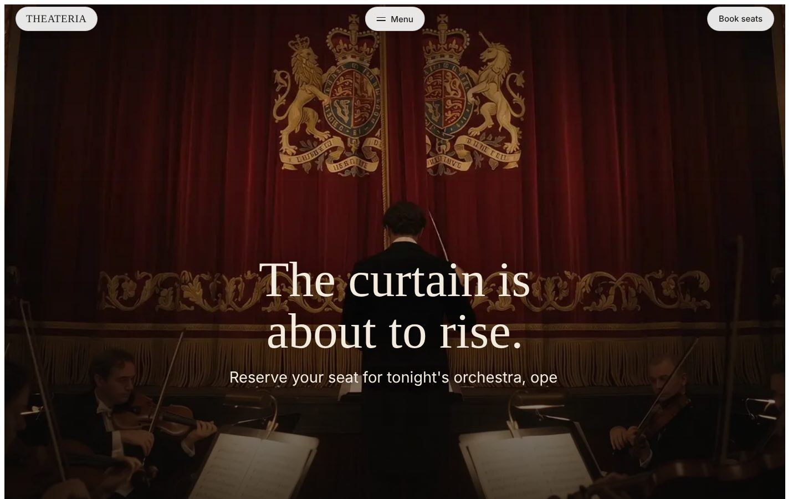](https://theateria.vercel.app)

Theateria is a single hall theatre with ten rows of ten seats. A visitor picks a program, chooses exact seats on a map, and pays in four steps. The site runs as plain static files, so any static host can serve it.

Live site: https://theateria.vercel.app

## The problem

Most theatre sites sell a ticket by section, not by seat. People do not see where they will sit, how far the stage is, or whether the seat next to theirs is taken. Seats also stay blocked while someone fills in a form, so the same seat can look free and then fail at payment.

Theateria shows every seat on one map, holds the chosen seats for five minutes, and refuses a selection that leaves a single empty seat in a row.

## What it does

**Visitors**
- Seat map of the full hall with zoom, fullscreen and a 360 view of the stage, the balcony and the top row
- Three tiers: VVIP rows A and B at 120 GBP, VIP rows C to E at 75 GBP, Regular rows F to J at 40 GBP
- Up to 8 seats per booking, with a 2 GBP fee per seat
- Six programs this month, with a preview that follows the cursor
- Gallery of 12 photos with a full screen viewer, keyboard and swipe support

**Checkout**
- Four steps: review, details, payment, confirmation
- Guest names, access needs and the promo code OPENING10
- Receipt and ticket with a QR code

**Behind the scenes**
- 5 minute hold on chosen seats, with one 2 minute extension
- Single seat rule: a selection cannot leave one empty seat in a row
- Intro sequence of 96 frames, skippable, and section animations that respect reduced motion

## Screens

### Desktop

[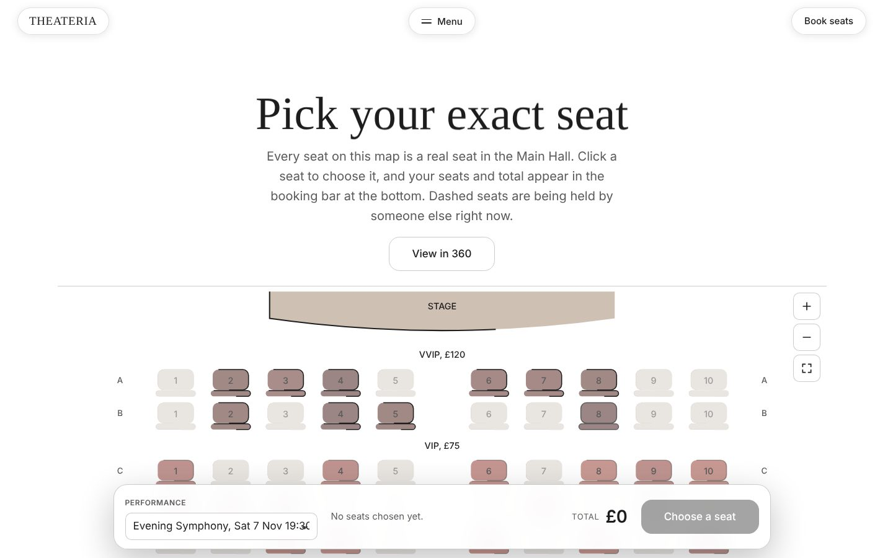](docs/images/d-seats.jpg)

| | |
|---|---|
| [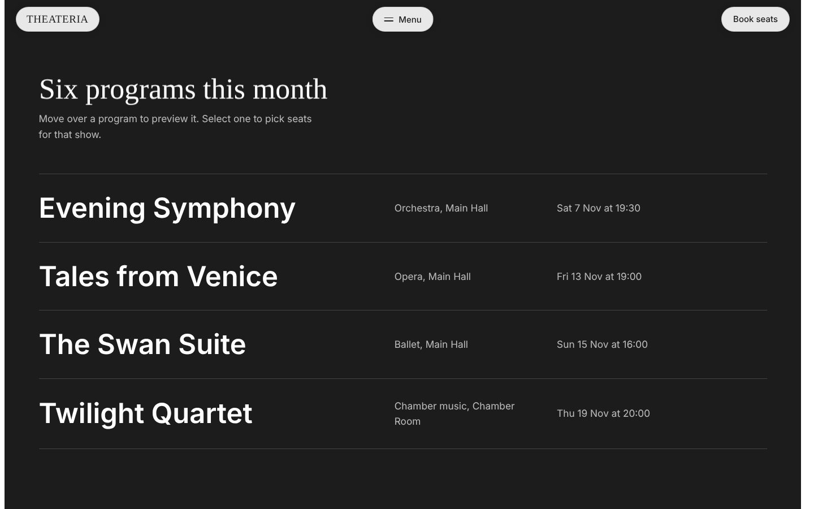](docs/images/d-schedule.jpg)<br>**Six programs** | [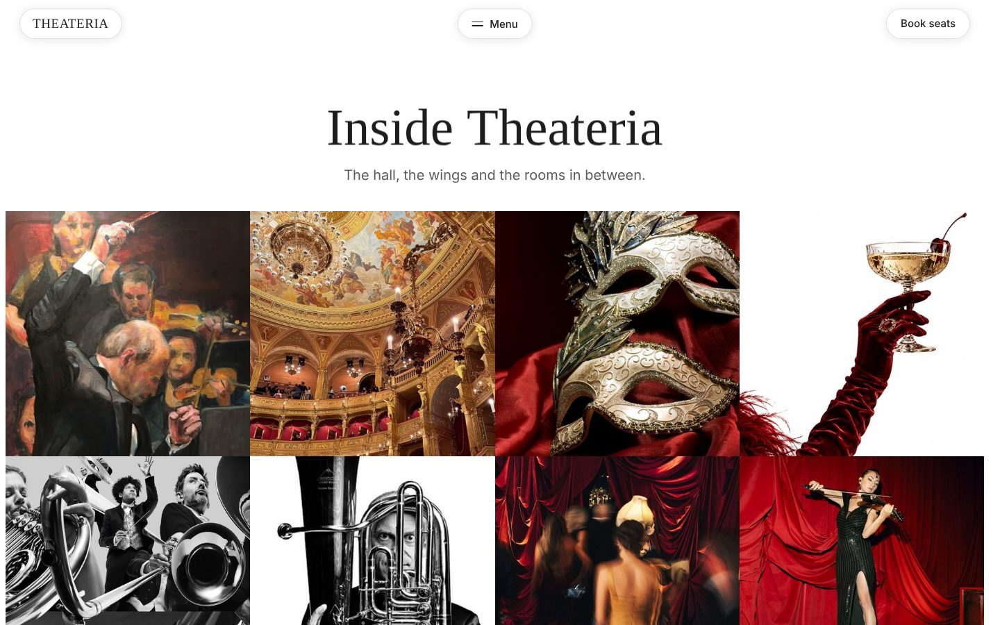](docs/images/d-gallery.jpg)<br>**Gallery** |
| [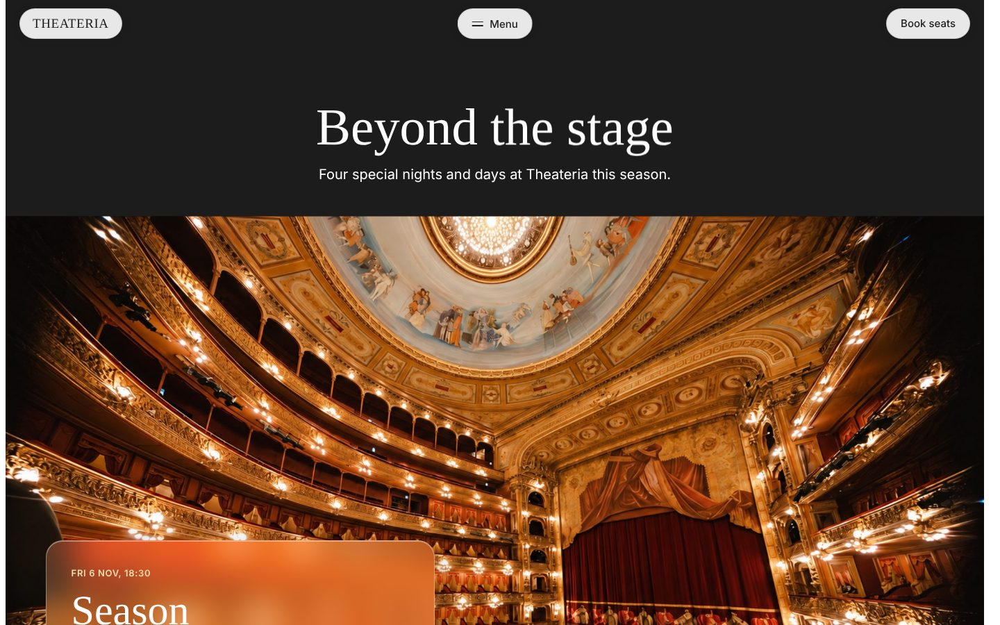](docs/images/d-events.jpg)<br>**Beyond the stage** | [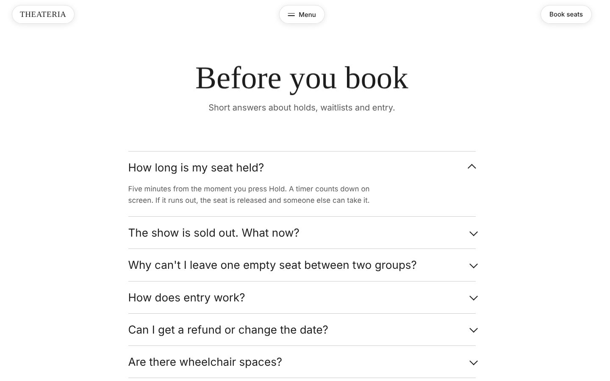](docs/images/d-faq.jpg)<br>**FAQ** |

### Mobile

| | | |
|---|---|---|
| [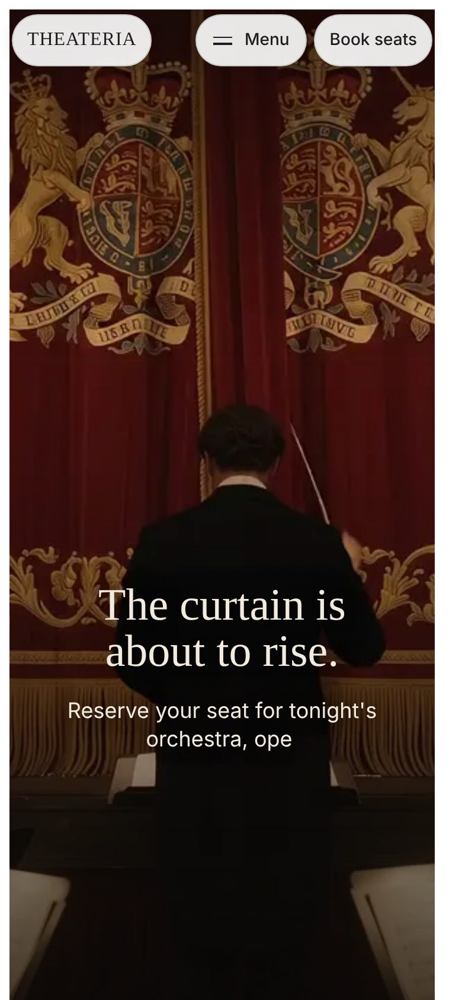](docs/images/m-hero.jpg) | [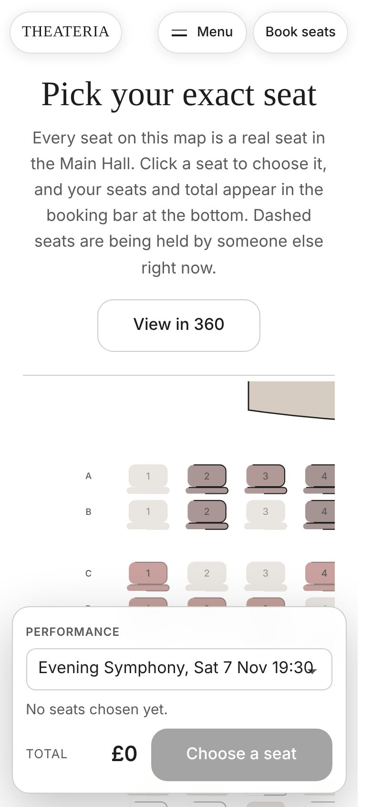](docs/images/m-seats.jpg) | [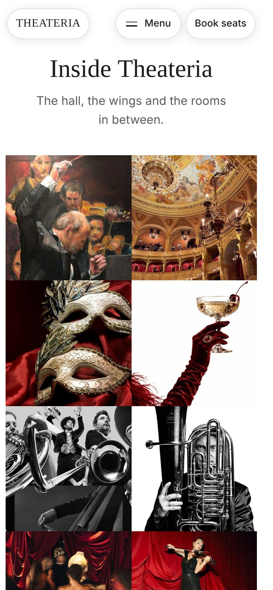](docs/images/m-gallery.jpg) |

## How it works

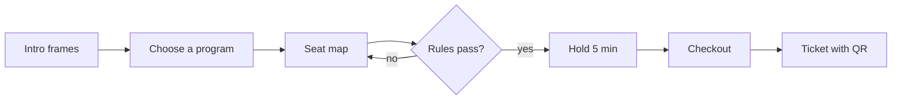

### Booking lifecycle

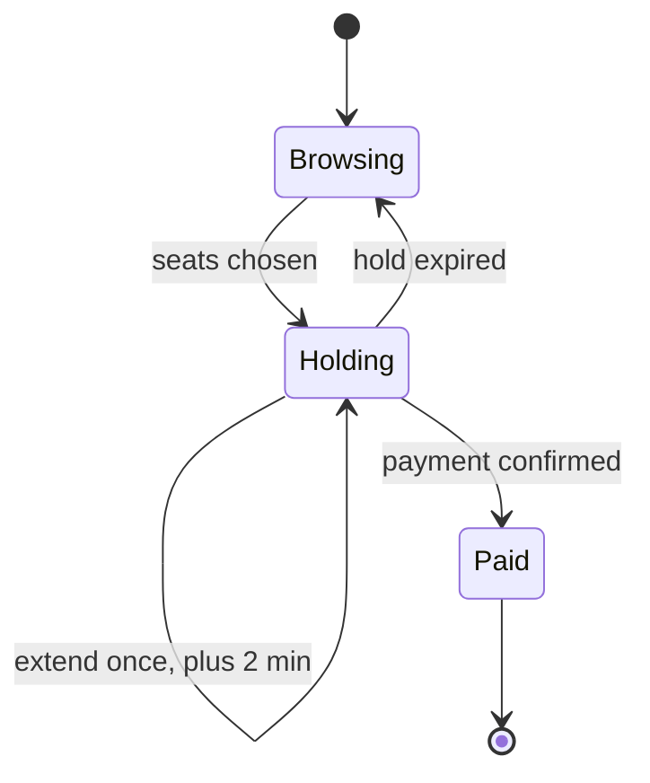

## Tech stack

| Layer | Choice |
|---|---|
| Markup and styles | Plain HTML and CSS |
| Scripts | Vanilla JavaScript, loaded with plain script tags |
| Animation | GSAP 3.12 with ScrollTrigger |
| 360 view | three.js r128 |
| Type | Faculty Glyphic for headings, system sans (SF Pro, Inter) for body |
| Hosting | Vercel, static |

## Project structure

```
theateria/
├── docs/              product, booking rules, architecture, design system, setup
│   └── images/        screenshots used in this README
├── img/               photos, gallery tiles and event images
├── frames/            96 intro frames
├── views/             360 view images
├── scripts/
│   └── check.mjs      script syntax and local file check, run by CI
├── index.html         page markup and meta tags
├── theateria.js       page script: seat map, hold timer, 360 view, checkout
├── schedule.js        program list with cursor preview
├── media.js           gallery, photo viewer and event images
├── animation.js       section load animations
├── theateria.css      all styles
├── LICENSE            MIT
└── README.md
```

## Quick start

```bash
git clone https://github.com/yosrend/theateria.git
cd theateria
python3 -m http.server 8080
```

Open http://localhost:8080. GSAP and fonts load from public CDNs, so the browser needs a connection. Full steps are in [docs/setup.md](docs/setup.md).

## Documentation

| Doc | What is inside |
|---|---|
| [docs/product.md](docs/product.md) | Audience, scope and what the site does not do |
| [docs/booking-rules.md](docs/booking-rules.md) | Tiers, fees, limits, hold timer, orphan seat rule, promo |
| [docs/architecture.md](docs/architecture.md) | How the page loads and what each script does |
| [docs/design-system.md](docs/design-system.md) | Type, color, motion and component notes |
| [docs/setup.md](docs/setup.md) | Run locally and deploy to Vercel |

## Status

A working front end built as a portfolio piece. Payment and the seat hold are simulated in the browser. There is no real charge and no server side seat inventory in this version.

## Author

Built by [Yosep Rendi](https://github.com/yosrend), UI/UX and product designer at Morae Studio.

## License

[MIT](LICENSE). Copyright 2026 Rendi.
