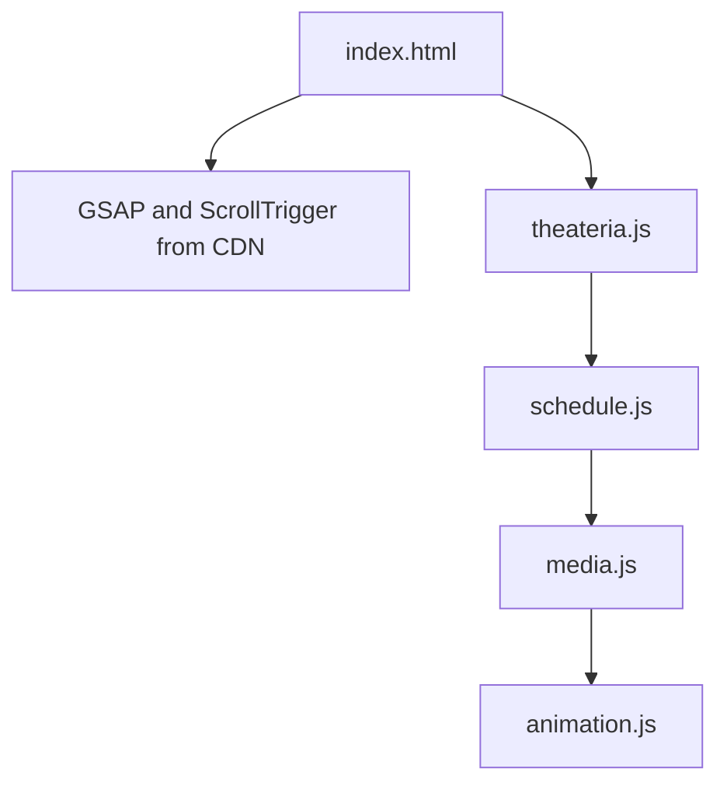

# Architecture

The site is static. `index.html` holds the markup and loads `theateria.js` with a normal script tag. Nothing is fetched or patched at runtime.

Earlier versions loaded the original script as text and applied patch files on every page load. Those patches are now part of `theateria.js`, so the browser runs the same code with one request less and no synchronous XHR.

## Load order

## Files

| File | Job |
|---|---|
| index.html | Markup, intro, meta tags |
| theateria.js | Page script: seat map, hold timer, 360 view, booking summary and four step checkout |
| schedule.js | Rebuilds the programs section as a list with a cursor preview |
| media.js | Builds the gallery and viewer, swaps the event images |
| animation.js | Word mask reveals on headings, clip reveals on event images |
| theateria.css | All styles |
| scripts/check.mjs | Syntax check for every script and a check that each local file used by `index.html` exists |

## Notes

- `theateria.js` loads `schedule.js`, `schedule.js` loads `media.js`, and `media.js` loads `animation.js`, so the order is fixed
- Pointer effects run only on devices with a fine pointer and hover
- Animations are skipped when the visitor prefers reduced motion
- All images use paths relative to the site root
- three.js r128 loads from a CDN when the 360 view is first needed
