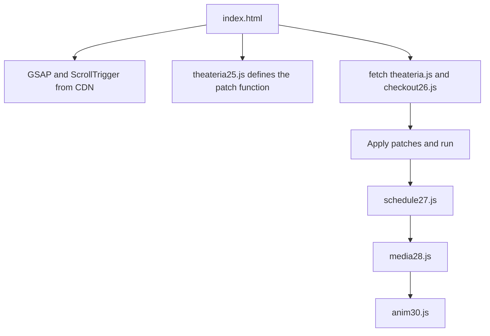

# Architecture

The site is static. `index.html` contains the markup and a small loader. The loader fetches `theateria.js` as text, applies patches, then runs the result. This keeps the original script untouched and puts each change in its own file.

## Load order

## Files

| File | Job |
|---|---|
| index.html | Markup, intro, loader |
| theateria.js | Original page script: seat map, hold timer, 360 view |
| theateria25.js | Patches to the original script, runs checkout26.js |
| checkout26.js | Booking summary and four step checkout |
| schedule27.js | Rebuilds the programs section as a list with a cursor preview |
| media28.js | Builds the gallery and viewer, swaps the event images |
| anim30.js | Word mask reveals on headings, clip reveals on event images |

## Notes

- Each later file loads the next one, so the order is fixed
- Pointer effects run only on devices with a fine pointer and hover
- Animations are skipped when the visitor prefers reduced motion
- All images use paths relative to the site root
